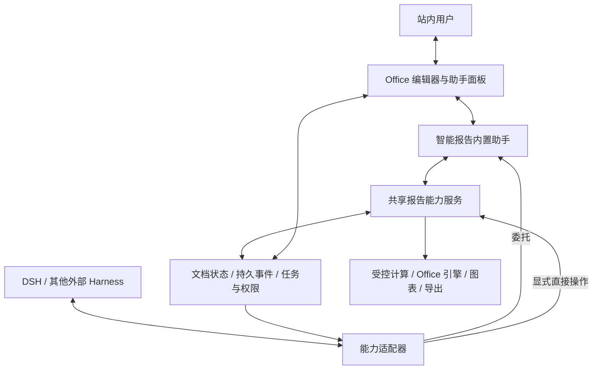

# 智能报告助手、多 Harness 与 Office 实时同步实施计划

更新：2026-11-14。当前交付：设计、任务清单与审查记录；产品实现待执行，生产未启用。本文件是唯一当前计划入口，取代此前默认委派内置 Codex、固定报告工作流及以进度展示替代实时同步的安排。实施顺序不是产品固定工作流：运行中由助手或所选外部 harness 自主规划、按需调用能力。

## 1. 已确认目标

1. 智能报告内置助手可以读取、分析、编辑报告、计算指标、生成图表及导出 Office；助手是自主 agent/harness，不是固定阶段工作流包装器。
2. 外部 DSH、Codex、Claude 或其他 harness 可委托内置助手，也可直接操作报告。DSH 是首个适配器，不是唯一入口；第二种真实 harness 必须用于验收通用性。
3. 常用入口是委托内置助手；直接操作需显式选择并具备服务端授权和能力。站内用户直接与内置助手协作。
4. 同步对象包括报告正文、表格、图表、幻灯片/页面对象、用户编辑和反馈；token、状态或下载链接单独更新不算实时双向同步。
5. 固定报告工作流弃用。现有事实、计算、权限、任务持久化、版本和产物核验作为独立能力保留；不重建另一套通用调度或模型循环。
6. 五格式目标为 MD、DOCX、XLSX、PPTX、PDF；实时对象预览与固定修订文件导出分开验收，不承诺浏览器和桌面 Office 像素等价。

## 2. 基线、已有成果与证据边界

原始文档编辑工作区 HEAD 为 `1138887d`（#223）；PR #228 实际基于 `ca091c5720e0a6ba4b7137abe7f6d795bc7f1dfb`（#227），只提交文档。已读取该基线以及 #226 精确提交 `a9b55c65`；后续实现应先核对最新主分支、适用 AGENTS.md 和未提交修改，不能直接在旧代码树接入新接口。

- #226：Agno 3.1.12、Codex SDK/CLI 0.163.0 锁定，元数据客户端直接注入，协程级状态/租约/deadline 守卫与取消清理已交付。
- 本轮独立导出 #226 源码，两个新增测试文件 31 passed、1 个第三方弃用 warning；复用本机依赖。不是全新依赖验证，不替代 PR 作者的117项证据。
- 当前应用 `app.py` 的 `MCPConfig` 显式发布 `report_workflow.as_tool(name="run_reporting_workflow")`，并启用原生 `continue_run`/`cancel_run`；`default_tools=False`。`reporting_mcp/tools.py` 的 start/get/review/cancel 是未装配到生产 MCP 的旧适配层。两条代码路径需分别盘点，新能力入口必须替换实际应用装配，不能仅修改旧适配层。
- `AgentEventLog` 仍是128条进程内事件记录，不能当耐久文档日志；已有编辑器 SHA/版本冲突保护可复用，尚非协同合并。
- 已有四格式原生编辑器、读写桥及修订保存能力；#227 不等于多 harness 同步或全格式完整验收。
- DSH 官方提供 Session 控制/历史/follow 和实时流；实际接入版本、原生 A2A、真实取消/恢复仍需探针。

依据：[PR #226 审查](../../reviews/2026-11-14-pr226-harness-review.md)、[可行性分析](../../reviews/2026-11-14-multi-harness-feasibility.md)。旧 Task17–41 等历史记录不自动算作当前代码或验收完成。

## 3. 架构与执行归属

| 入口 | 规划执行者 | 写入归属 | 追加/取消 |
|---|---|---|---|
| 站内助手 | 内置助手 | 内置助手获授权范围 | 用户通过同一任务发送 |
| 外部委托 | 内置助手 | 外部协调，内置助手写入受托范围 | 外部与站内可经授权操作同任务 |
| 外部直接操作 | 选定外部 harness | 外部自身获授权范围 | 适配器映射原生会话与执行 |

内置助手不固定绑定 Codex 型号或专有 SDK；优先复用锁定 Agno 已有 agent/tool/session 能力，provider 及 harness 选择以真实能力验证为准。生产不可用时明确返回原因，不静默换模型、模式或执行者。外部委托不得递归委托回自己；记录父任务、执行者和委托链，限制循环。

同一受托范围避免双主。初版同一对象只允许一个 agent 写入者；用户始终可编辑，提交使旧 baseVersion 失效。不同对象并行还须检查删除/移动父节点、表格结构等依赖。转交执行权先撤销旧租约、对账在途操作，再授予新执行者；无法确认停止则保留 unknown 并拒绝冲突写入。

## 4. 协议与最小数据合同

### 4.1 接入策略

- MCP：发现和调用受控报告能力，不将整个旧 workflow 包装成一个新工具。
- A2A：按 harness 能力提供发现、委托、追加、状态、产物通知；固定双方版本并实证，不假设 DSH 已原生支持。A2A产物分块不等于文档一致性协议。
- 适配器：支持原生 SDK/Host 插件的客户端复用其公开接口。客户端不必实现本项目私有 WebSocket；可用工具调用配合通知或增量读取。
- 浏览器：初版 HTTP操作提交+SSE推送，评估高频需求后决定WebSocket；两种传输共享合同、鉴权和回执。
- 实时 token 只驱动临时显示；正式文档变化由已校验的操作生成。不得执行模型正文伪工具调用。

### 4.2 业务合同（以下字段为拟实施，并非第三方 SDK API）

| 合同 | 最小语义 |
|---|---|
| HarnessCapabilities | adapter/version、原生会话、工具、订阅、steer、取消确认、恢复、用量计量能力；unknown不得算支持 |
| ExecutionBinding | taskId、parentTaskId、controller/executor、mode、documentId、输入/模板身份、权限、租约epoch、预算 |
| DocumentSnapshot | documentId、format、documentVersion、对象稳定ID及版本、来源绑定、lastSequence |
| DocumentOperation | operationId、documentId、目标objectId、baseVersion、操作类型及类型化参数；actor和scope由认证上下文绑定 |
| OperationReceipt | accepted/conflict/rejected、实际版本、变更引用、原因；接收与提交状态分别记录 |
| DocumentEvent | eventId、documentId、sequence、版本、operationId、origin/causation、actor、类型、授权载荷 |
| Interaction | taskId、requestId、目标用户、版本、问题/回答状态；只能处理一次 |
| ExportReceipt | 目标格式、冻结文档版本、输入/模板身份、实际文件身份、validation及下载授权 |

同operationId同输入返回原回执，不重复写；同ID异输入返回冲突。对象ID跨移动保持稳定，删除产生墓碑；导入、拆分/合并及重新解析须定义映射，不能用不稳定数组下标当身份。原子批量操作全成或全败；跨外部引擎操作先登记intent，超时进入unknown并对账，不盲目重放。

### 4.3 持久化与一致性

复用现有数据库和任务仓储，确认缺口后增加文档操作、事件/outbox、adapter binding存储。文档版本变更、操作回执和outbox在同一数据库事务提交；发布器可重试，消费者按sequence和eventId去重。外部文件写入不伪称跨库原子事务：先生成不可变候选，核验后以版本CAS登记；失败候选隔离回收。

快照含一致性游标；订阅从该游标继续，解决读快照与建立连接之间的漏事件。过期游标要求重新拉取快照；存在明确事件保留策略。UI未确认操作可乐观显示，但必须区分pending/committed/conflict，不把未保存内容发作已提交事实。背压可合并预览刷新，不能丢弃已提交操作。

## 5. Office 实时双向同步

| 格式 | 第一批操作 | 渲染策略 | 必验边界 |
|---|---|---|---|
| MD/正文 | 段落插入/修改/删除、表格、静态图引用 | 块级增量，长文本按句/段提交 | 用户选区、Undo、中文输入法、来源失效 |
| DOCX | 段落、表格单元格、图片 | 局部对象更新，分页合并调度 | 跨页表格、字体、样式、保存重开与非目标部件 |
| XLSX | 单元格/区域、公式、样式、图表 | 受影响单元格重算及图表更新 | 依赖公式、合并单元格、排序/插行、范围身份 |
| PPTX | 幻灯片文字、图片、表格、图表对象 | 更新目标页及缩略图 | 对象移动/删除、布局/母版、非目标页 |
| PDF | 已支持文字对象、批注、表单、图片 | 页面对象覆盖及受影响页重绘 | 页面坐标/旋转、真实文件回读、正文重排限制 |

复用现有模型和桥接能力，复杂对象不支持则明确返回，不能重新生成整份文件冒充定点修改。Office二进制是固定修订的产物，不逐token上传完整ZIP/PDF。图表生成保持Matplotlib PNG/JPEG；不新增Plotly。

初版对象操作+版本检查。只有同段高频多人输入确有需求，且编辑器/Undo/来源绑定验证通过后引入成熟Yjs/CRDT；不自制CRDT，不宣称它解决公式、图表与PDF语义冲突。远端应用操作标记origin，避免触发本地监听后再次上传；用户Undo只撤销允许范围并按当前版本提交逆操作。

用户修改提交后通知责任harness并标记最新上下文。正在推理的请求无法保证立刻吸收变化；下一次工具读写必须核版本，陈旧写入拒绝并要求读取/重规划。无需每个键击都向模型发请求，可合并已提交摘要；不能静默丢掉关键修改。

## 6. 分阶段任务与交付

以下路径为复用候选；新增模块/测试名明确标“拟新增”，实施前核对最新树，避免创建重复服务。

2026-11-14 推进优先级更新：先完善内部 harness；M0 拆分为内部源码/权限/工具合同基线和外部适配探针。完成直接相关的内部基线与回归后，可以独立修复现有内部助手并推进 M1 内部能力，不以 DSH、原外部插件、第二 harness 或其凭据可用为前置条件。下表中的 A 依赖对内部交付仅指内部基线；外部委托/direct 及多 harness 验收仍需各自真实探针。不得用内部定点修复宣称 M1、同步或整体产品完成。

### M0：基线与真实协议探针（对应N0）

- [ ] 核对最新主分支、#226/#227实际归属、当前编辑器模型与既有修改；保存明确源码SHA。
- [ ] 锁定官方DSH源码/SDK版本；定位原dsh-smart-reporting插件源码，旧文档中的机器路径不当作当前可用文件。
- [ ] 用合成文档验证真实prompt、工具调用、follow/重连、用户追加、取消及恢复，记录支持/不支持/unknown。
- [ ] 选择第二种实际可用harness；不按品牌猜接口。选定其适配路径和部署身份。
- [ ] 盘点固定工作流消费者与共享能力，列出解耦清单及在途任务处理方案。

交付：能力矩阵、版本/事件样本、依赖图；没有真实接通的项保持待办。不得因探针缺生产凭据而伪造通过。

### M1：共享报告能力与助手执行（对应N1）

修改面：app.py 的 MCPConfig/应用装配、reporting/agent.py 与 workflow/controller.py 的 facade 消费者、reporting_mcp/{contracts,tools,adapter,identity}.py、report_editor/{service,native_publication,workbook_api,slides_api}.py、reporting/trace/*_service.py、task_execution及应用装配。

- [ ] 将受控读取/计算、文档对象读写、静态图、导出从workflow上下文解耦；优先抽取服务层，避免复制业务算法。
- [ ] 基于Agno已有agent/tool/session装配内置助手；自主选择工具，支持用户补充、工具失败后的有限修复。
- [ ] 定义委托/直接执行合同及能力发现；缺省外部委托内置助手，显式direct只运行选定外部执行者。
- [ ] 服务端绑定身份、文档和权限；正式业务数字只能由受控计算登记，人工改值使原来源绑定失效。
- [ ] 取消先封新动作，状态与租约在提交边界检查；复用#226守卫并补真实外部进程停止确认。

验收：新调用链不进入固定workflow启动器；两种入口调用同一服务；direct内置run数为0；委托范围内外部不重复写。拟新增 test_harness_execution_contract.py，结合既有MCP/租约测试定点验证。

### M2：权威文档与耐久同步（对应N2/N3）

修改面：现有报告修订服务、task_execution/repository_impl.py、数据库迁移；拟新增report_editor/document_sync/，仅容纳确有缺口的合同、操作、事件及传输。

- [ ] 稳定对象ID、版本CAS、操作幂等、批量原子性、失败及unknown回执。
- [ ] 文档变更与outbox事务；服务重启仍可读回已提交结果，不以AgentEventLog作为恢复源。
- [ ] HTTP提交、SSE订阅、快照游标补发、撤权、origin去回声、背压；仅在探针证明必要时扩展WebSocket。
- [ ] 真PostgreSQL双连接验证取消/完成、租约接管/旧写入和锁顺序；SQLite测试不替代并发证明。

验收：重复/乱序/丢确认/重启后最终文档及回执一致；不存在静默覆盖、跨文档事件或漏授权。拟新增test_document_sync_transactions.py、test_document_sync_recovery.py。

### M3：正文与Word真实闭环（对应N4/N5）

修改面：frontend/src/{docx-main.tsx,draft.ts,native-draft.ts,save-state.ts,office-assistant-panel.ts}、已有DOCX桥及原生修订服务；拟新增共享document-sync-client.ts。

- [ ] 绑定稳定对象及selection，远端变更增量应用，保留焦点/输入法组合和本地未确认修改。
- [ ] 内置助手改段落→服务端提交→页面更新；用户改同段→助手收到通知→旧版本写入被拒→读取后继续。
- [ ] DSH委托上述同一任务，原生会话追加/回答；浏览器显示同一份文档，外部接收已提交变化。
- [ ] 长文本临时预览、段落提交与分页调度；保存/下载/重开核对同一版本。

验收：真实DSH、真实助手及真实浏览器往返；模拟仅验证故障合同，不冒充真实模型闭环。浏览器测试覆盖中文、断线、本地未保存输入和Undo。

### M4：Excel实时编辑与第二Harness（对应N4/N6/N7）

修改面：frontend/src/{workbook-main.ts,workbook-draft.ts,workbook-native-ai.ts}、workbook_api.py及workbook_engine。

- [ ] 类型化单元格/范围/公式操作，重算依赖与图表刷新；区分显示值、公式及正式业务事实。
- [ ] 处理排序、插行/删列、合并区域引起的目标变化；先检查结构版本，拒绝旧坐标错误写入。
- [ ] 第二真实harness复用合同完成委托和直接操作支持项；适配器不侵入文档核心。
- [ ] 两harness修改不同对象、同对象冲突、用户抢先修改、转交与迟到结果均验证。

验收：保存前预览、保存后独立reader、重开与导出同修订一致；第二harness能力不足的模式标未验收，不能计作通用性完成。

### M5：PPTX/PDF与格式完整性（对应N4）

修改面：frontend/src/{slides-main.ts,pdf-main.ts}、slides_api.py、native_api.py、native_publication.py、已有PPTX/PDF桥。

- [ ] PPTX按对象/幻灯片同步并更新缩略图；删除父对象时拒绝迟到子对象修改。
- [ ] PDF按已支持编辑对象和页面同步；不支持的正文重排明确说明，不自动转成Word工作流。
- [ ] 四格式目标对象、非目标内容、页面几何、样式、保存下载重开逐类证据。
- [ ] MD及四种Office格式各自验证目标格式，不能借另一个文件冒充交付。

### M6：生命周期、性能与导出（对应N5/N7）

- [ ] 取消/超时覆盖助手、外部执行者、脚本、SQL/HTTP及Office提交；不响应取消时显式unknown，不提前释放冲突写权。
- [ ] 固定修订导出、模板身份与来源登记，独立回读、历史只读访问及逐接收端下载授权。
- [ ] 租约/修订/输入权限在恢复后重核，已完成操作不重复执行；旧harness上下文不得冒充新会话。
- [ ] 测模型推理、操作提交、事件投递、页面绘制和导出各段耗时；记录测试规模、网络及源码身份。
- [ ] 建议初始目标：测试网络下提交至显示P95<500ms（常规小操作），断线补发不丢已提交操作；长文分页/大表重算另立预算并记录实际结果。
- [ ] 记录实际用量与根/子预算；不可计量标unknown，不以一次arun或timeout冒充模型请求次数硬帽。

验收：真实故障链与最终状态证据，不只HTTP 200；无全量测试重复运行。

### M7：固定工作流与旧执行器退役（对应N8）

- [ ] M0起停止新增固定workflow专用能力；新服务就绪后切换站内/外部入口并禁止创建旧链新任务。
- [ ] 登记在途旧任务：有限排空或明确取消，对账副作用；不把旧运行状态转成新harness会话。
- [ ] 按消费者清单迁移计算、叙述、图表、编辑重绘、模板和导出；替代证据齐全后删除固定编排与无引用CodeMode/kernel专属代码。
- [ ] 未迁移共享函数保持可用，不能按目录名称整段删除；旧产物身份/修订/下载继续访问。
- [ ] 部署采用同一锁文件；发布失败时可停新任务并保留已提交文档，回退不得复活双执行者或丢新格式数据。

验收：新报告路径没有固定阶段启动和旧CodeMode执行依赖；站内助手、外部委托/直接操作及五格式真实证据齐全。生产部署仍需明确授权，不由文档commit触发。

## 7. PR拆分与推进依赖

| 批次 | 交付 | 前置 |
|---|---|---|
| PR-A | M0探针与能力矩阵、服务解耦清单 | 最新基线 |
| PR-B | M1内部共享能力与内置助手；外部委托/direct可后续独立交付 | 内部基线与直接受影响合同；外部部分另依赖真实探针 |
| PR-C | M2文档操作、耐久事件和恢复 | A，接口与B对齐 |
| PR-D | M3 Word/正文+DSH委托真实闭环 | B+C |
| PR-E | M4 XLSX+第二harness、并发协调 | D |
| PR-F | M5 PPTX/PDF及格式验证 | C，复用D/E同步适配 |
| PR-G | M6生命周期、性能、五格式导出 | D/E/F |
| PR-H | M7最终删除、迁移及发布准备 | G及消费者证据 |

每个批次交付实现、直接受影响测试、失败记录和边界说明。现有内部链路的独立缺陷修复可从最新 code 开 draft PR，不必等待外部探针；整体多 harness 工期仍待探针结果。现阶段不承诺缺乏探针依据的日期。阶段名称仅供研发拆分，不进入用户报告执行流程。

## 8. 必须保持的项目契约

- AGENTS.md中的非阻断签发用例全部适用于导出/签发改动；新失败点登记test_http_publication_lineage.py，新签发函数登记_SIGNING_CHAIN。
- 业务语义校验采用消歧和软告警；验收失败返回具体原因，已生成且身份可核验的文件仍可下载，不伪称验收通过。
- 权限/输入身份不符拒用对应资源；业务DB凭据不进入harness或浏览器。同步不能扩大原可见范围。
- 应用日志loguru；静态图Matplotlib；不新增Plotly；优先复用Agno，避免再造执行框架。
- 保留Agno3.1.12及现有显式override依据，实施前核当前锁；Codex使用时不恢复DockerSandbox或自动full-access。
- 不重复完整测试；选择直接受影响nodeid。业务签认未执行时保持not_performed，技术验证不能代替业务签字。
- 提交只纳入本任务文件，保留他人工作。当前计划不要求子agent或并行代理。

## 9. 完成定义与下一步

完整完成需同时具备：内置助手自主执行；至少两个真实外部harness接入证据；委托与直接模式支持范围明确；用户/助手/harness文档双向同步；冲突、取消、断线及进程恢复正确；五格式保存/导出/独立回读；固定工作流退役；性能和权限边界可复核。

下一步优先推进内部 harness：冻结最新主分支与内部合同基线，修复已有助手能力缺口并补回归，再实施内部共享能力和耐久文档操作。DSH插件、第二harness和真实外部探针作为后续适配任务，不能阻塞内部独立交付。当前所有M0–M7 checkbox保留未完成，文档提交不代表产品能力交付。
