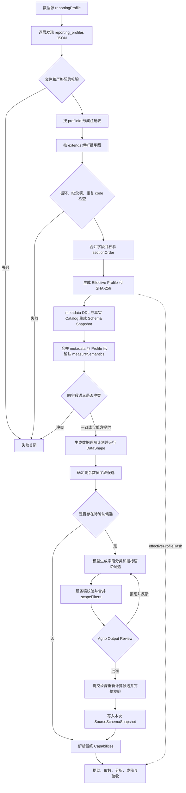

# Report Agent Profile 配置规约

本文是 Reporting Profile 的唯一专用说明。Profile 负责表达稳定、可审核的物理字段绑定、单位、粒度、
医院/院区别名、对账规则、固定数据范围和文档品牌；它不保存连接信息，也不根据字段名猜测会随数据
变化的聚合口径。医院运营报告的顶层章节由 `hospital_operation` 固定契约维护，Profile 不是章节事实来源。

## 整体流程



关键边界如下：

- 模型只能提出候选，不能写 Profile、Workflow state 或自行批准语义。
- 用户批准后，独立提交步骤重新基于当前 Snapshot 计算候选集合；缺项、增项、未知字段和范围冲突均
  失败关闭。
- Profile `scopeFilters` 是服务端强制范围，会确定性进入指标 `exclusiveScope`，模型不能删除或覆盖。
- `effectiveProfileHash` 覆盖所有生效层及最终的 `documentBranding`、`pageLayout` 内容，PDF 和 Word
  产物都必须绑定该 hash。

## 目录与加载

每个配置层的文件位于 `reporting_profiles/**/*.json`。子目录只用于整理文件，不产生隐式语义；
`hospitals/`、`organizations/` 和 `templates/` 都不是保留关键字，继承关系只由 JSON 中的 `extends`
决定。

加载器从部署配置边界到本次运行目录逐层查找 `reporting_profiles/`：

1. 父目录先加载，越接近运行目录的配置层越晚加载。
2. 子配置层出现相同 `profileId` 时，整份文档替换父配置层的同 ID 文档，不做跨目录字段级合并。
3. 注册完成后，再依据 `extends` 解析 Profile 内部继承。
4. 文件必须是普通 UTF-8 JSON，单文件不超过 1 MiB；目录和文件均不接受符号链接。
5. 最多加载 500 个生效 Profile。未知字段、同层重复 ID、无效 JSON 或连接字段均拒绝。

部署示例位于
[`deploy/agentos/reporting/reporting_profiles/`](../../../../deploy/agentos/reporting/reporting_profiles/)：

| Profile | 分层职责 | 直接父 Profile |
| --- | --- | --- |
| `base` | 领域无关的五个中文基础章节和默认版式 | 无 |
| `ruijin` | 瑞金医院真实 Schema 的稳定维度映射和经营章节 | `base` |
| `ruijin-north` | 北部院区固定范围覆盖 | `ruijin` |
| `finance` | 财务条线章节和版式差异 | `ruijin` |
| `monthly-operation` | 月度经营报告模板 | `ruijin` |
| `budget-execution` | 预算执行专题模板 | `ruijin` |

数据源只引用最终要解析的一个 Profile ID：

```json
{
  "id": "rj",
  "type": "starrocks",
  "dsnEnv": "REPORT_STARROCKS_DSN",
  "reportingProfile": "ruijin"
}
```

StarRocks 数据库名从 `dsnEnv` 指向的 DSN 路径解析，例如 DSN 末尾的 `/dwd`。旧配置仍可显式
声明 `database`，但该值必须与 DSN 一致。

一次运行选择的所有数据源必须绑定同一 `reportingProfile`。未配置时使用内置的领域无关 Profile。

## 分层与继承

`extends` 可以包含多个父 Profile。父项按声明顺序解析，后解析的父项覆盖先解析的同名字段，最后应用
当前 Profile。共享祖先只合并一次，循环和缺失父项直接失败。

以下字段按稳定 `code` 合并：

- `dimensions`
- `metrics`
- `reconciliations`
- `scopeFilters`
- `sections`

子层只需写需要覆盖的字段；`{"code": "service_workload", "enabled": false}` 会删除继承项，停用对象
不得包含 `code`、`enabled` 之外的字段。`measureSemantics` 不使用 code，而是按不区分大小写的完整
`fieldRef` 覆盖。`pageLayout` 和 `documentBranding` 分别按具体字段覆盖。

医院、院区、条线和模板需要同时生效时，应增加一个最终组合 Profile，而不是依赖目录名。组合层必须
显式给出覆盖所有最终章节的 `sectionOrder`，例如：

```json
{
  "version": "1",
  "profileId": "ruijin-north-finance-monthly",
  "revision": "1",
  "extends": ["ruijin-north", "finance", "monthly-operation"],
  "sectionOrder": [
    "executive_summary",
    "scope_and_methodology",
    "financial_overview",
    "income_and_budget",
    "cost_and_expenditure",
    "project_budget",
    "financial_risk",
    "trend_analysis",
    "structure_analysis",
    "contribution_analysis",
    "anomaly_analysis",
    "key_findings",
    "limitations",
    "recommendations"
  ]
}
```

上例只说明组合方式。是否保留工作量章节、财务章节和模板章节，应由部署方按实际报告职责确定，不应由
Python 代码写入某家医院的条件分支。

## 顶层契约

Profile 使用严格 JSON，所有未知字段都会被拒绝：

| 字段 | 必填 | 作用 |
| --- | --- | --- |
| `version` | 是 | 固定为 `"1"` |
| `profileId` | 是 | 稳定 Profile ID，供数据源引用 |
| `revision` | 是 | 部署方维护的配置修订号 |
| `extends` | 否 | 显式父 Profile ID 列表 |
| `dimensions` | 否 | 已确认的业务维度及其物理字段映射 |
| `metrics` | 否 | 已确认的基础指标或比率指标能力 |
| `reconciliations` | 否 | 两个基础指标之间的确定性对账规则 |
| `measureSemantics` | 否 | 已人工确认的物理数值字段聚合语义 |
| `scopeFilters` | 否 | 医院、院区或组织层的强制固定范围 |
| `sections` | 否 | 报告章节标题和能力依赖 |
| `sectionOrder` | 否 | 最终章节完整顺序 |
| `pageLayout` | 否 | 固定页眉页脚 |
| `documentBranding` | 否 | 机构名称、生成标记和水印文案 |

`fieldRef` 使用环境无关的 `sourceId.table.column`。运行时从所选数据源的 DSN 补充数据库后，才与
Schema Snapshot 中的完整 `sourceId.database.table.column` 引用比较。Profile 不能扩大 metadata DDL
和真实 Catalog 的交集，也不能包含 SQL、Python、自由表达式、DSN、host、用户名、密码或其他连接字段。

### dimensions

维度用于表达稳定业务含义。一个维度可以映射多张表中的同义字段：

```json
{
  "code": "area",
  "kind": "organization",
  "description": "院区；实际枚举和值域由运行时画像确定。",
  "fieldRefs": [
    "rj.dwd_income_budget_view.area",
    "rj.dwd_expenditure_budget_view.area"
  ]
}
```

数值类型不等于指标。年度、编码或等级等数值维度应在这里显式声明，避免进入指标语义候选。

### metrics

基础指标必须声明一个 `fieldRef`，聚合方式支持 `sum`、`count`、`count_distinct`、`average`；比率指标
使用 `ratio`，并引用已存在的分子、分母指标：

```json
{
  "code": "budget_achievement",
  "kind": "ratio",
  "description": "预算执行率。",
  "aggregation": "ratio",
  "numeratorMetric": "actual_income",
  "denominatorMetric": "budget_income",
  "zeroDenominatorPolicy": "disclose"
}
```

`zeroDenominatorPolicy` 仅允许 `disclose` 或 `null`。Profile metric 是能力定义，物理数值字段仍必须在
最终 `SourceSchemaSnapshot.measureSemantics` 中具有已确认语义。

### reconciliations

对账规则引用两个已存在的基础指标和已存在的维度 code。当前只支持聚合为 `sum` 或 `count` 的基础
指标；容差由 `absoluteTolerance` 和 `relativeTolerance` 给出：

```json
{
  "code": "income-cross-check",
  "leftMetric": "ledger_income",
  "rightMetric": "operation_income",
  "grain": ["month", "area"],
  "absoluteTolerance": 0,
  "relativeTolerance": 0.01
}
```

不能依据一次样本差异静态写入长期容差。只有业务契约确认稳定口径后，才应把对账规则放入 Profile。

### scopeFilters

固定范围是部署约束，不是模型建议。每项在每张表最多映射一个字段：

```json
{
  "code": "north-campus",
  "description": "本 Profile 只允许北部院区数据。",
  "fieldRefs": [
    "rj.dwd_income_budget_view.area",
    "rj.dwd_expenditure_budget_view.area"
  ],
  "value": "北部院区",
  "requiredForAllTables": true
}
```

`requiredForAllTables: true` 表示本次 Snapshot 的每张表都必须有该过滤项对应的字段。Profile 可以列出
Schema 表超集；未进入本次 Snapshot 的表不会扩大运行范围。已进入 Snapshot 的表存在缺字段、同字段
冲突值，或模型语义中的 `exclusiveScope` 与固定范围冲突时，Workflow 失败关闭。

### measureSemantics

`measureSemantics` 解决“物理字段是数值，但应该怎样统计”的问题：

```json
{
  "fieldRef": "rj.example.amount",
  "aggregation": "sum",
  "unit": "元",
  "additiveAcross": ["data_date", "area"],
  "exclusiveScope": {"income_type": "开单收入"},
  "reconcileWith": "rj.example_summary.amount",
  "tolerance": 0.01
}
```

- `aggregation` 支持 `sum`、`average`、`min`、`max`、`count`、`count_distinct`。
- `unit` 可选；明确单位优先保留。已确认 `kind=amount/currency` 的金额指标缺少单位时，服务端在冻结事实前按默认 CNY（元）登记；`CNY` 规范为 `元`。计数聚合及其他量纲不套用默认货币，不根据字段名或数值范围猜测。
- `additiveAcross` 只允许同一张受信表中的真实维度字段。
- `exclusiveScope` 只允许同一张表中的真实字段和值，表示统计该指标必须同时满足的固定口径。
- `reconcileWith` 和 `tolerance` 必须同时提供；对账字段必须属于受信 Snapshot。

冻结指标事实中的 `periodAggregation` 保留本次确认的时间口径：只有 `sum` / `count` 指标明确可沿报告期间字段（或逐行核验为同轴的别名）相加时登记为 `sum`；已确认时间不可加的求和指标登记为 `last`。旧事实缺少该字段时仍为空值，不使用当前 Profile 补写历史证明。该字段参与事实身份，口径改变会产生不同的 factId。

受控月均使用连续、完整的已登记月桶，并检查值缺失、期间缺失及告警；原始行平均值不能代替月均。检查覆盖的是登记窗口，不能据此声称全年或上游业务数据已经完整。新生成的月均与多月比较片段明确显示实际期间，并保留原有质量软告警和下载行为。

受控分组占比仅使用同一冻结指标的结构化分组和登记合计；总体须有明确固定范围，期间、单位、非负值及完整性均需符合条件。Top-K 不重新归一化，存量沿用最新登记期间。名称包含“合计”不构成跨指标总体隶属证明，旧事实只有分组展示名时也不升级为已证实。生成目录仅信任 checkpoint 登记的原始事实哈希，模型补充文件不能自行签发证明；质量不足仍为软告警，不影响已有可读 PDF/Word 下载。

受控分组排名采用竞赛排名：名次为严格更优的分组数加一，同值同名次（例如 1、2、2、4）。按未舍入登记值排序，显示金额相同不代表原值并列。Top/Bottom 保留对应降序/升序以及登记范围和期间，不把用于稳定展示的名称排序当作名次。百分比及复合单位的求和排名暂不签发证明。截断前缀不能证明唯一第一、并列总人数或完整排名表；编辑器修改名次、排序方向或改称唯一名次时重新复核，即使登记金额未变也不能直接视为句子已通过。

受控月度趋势核对至少三个连续登记月桶的每一对相邻未舍入值，区分严格上升、严格下降、完全持平及混合变化。源事实须明确 sum/last 时间口径、固定范围、单位及全窗口完整性；冻结的 `seriesMissingCount` 记录全序列缺失，数值聚合同时计入不可解析值，计数聚合保留其原始空值语义。该字段参与事实身份，旧事实缺少时保持未知，不能拿存量最新快照的 `missingCount=0` 推断以前各月也完整。趋势选择器仅服务端使用，显示期末登记值并保留全部核验窗口；端点增加、累计值、增长率、未来走势或显著性不能借用该证明。

metadata API 和 Profile 都可以提供已确认语义。同一字段内容完全一致时去重，不一致时返回
`report_measure_semantic_conflict`，不会静默选择任意一方。

若两者都未覆盖本次选表的数值候选，运行时流程会：

1. 先运行 DataShape，得到期间覆盖、空值率、基数、唯一性、数值分布和低基数 Top-K。
2. 排除已确认字段、Profile 维度和本次期间字段。
3. 模型结合 DDL 描述、metadata terms、Profile 和 DataShape，对每个剩余字段完整分类为 `measure`
   或 `dimension`；分类为指标时必须给出完整 `MeasureSemantic` 和中文理由。
4. 服务端校验候选字段全集、物理字段、可加维度、固定范围和对账引用，并合并 `scopeFilters`。
5. Agno Output Review 展示最终待提交对象；用户拒绝时携带反馈重试，批准后进入独立提交步骤。
6. 提交步骤重新计算候选并执行同一组完整校验，之后才写入本次运行的 Snapshot。

因此，聚合方式、重复粒度、完整期间、枚举和值域、跨表容差等强数据关联内容，在没有稳定业务契约时
不得写死在默认 Profile。程序可以发现冲突、重复、缺失和候选范围，但不能仅凭统计相关性替代业务
含义；无法确定的语义必须由模型提出并由用户确认。

### 动态报告章节

医院运营报告在详细分析计划冻结后动态生成章节。Profile 不再声明 `sections` 或 `sectionOrder`；模型提交中文标题、分析重点和 `analysisId` 引用，服务端按批准顺序生成并冻结章节 code。

### pageLayout

`pageLayout` 支持 `headerLeft`、`headerRight`、`footerLeft`、`footerRight`。只允许 `{title}`、
`{organization}`、`{page}`、`{pages}` 四种占位符，不允许 CSS 或格式表达式；最终页脚必须同时包含
`{page}` 和 `{pages}`。`{organization}` 始终展开为生效 `documentBranding.organizationName`，避免在
Profile 中重复维护机构名称。

### documentBranding

`documentBranding` 按字段继承，支持：

| 字段 | 默认值 | 用途 |
| --- | --- | --- |
| `organizationName` | `编制单位待确认` | 封面、页眉占位符和正文末尾落款；正式编制单位须由医院配置确认 |
| `generatedByLabel` | `AI 智能报告平台生成` | 封面底部生成标记 |
| `watermarkText` | `AI 智能报告平台生成` | 目录和正文页背后的斜向水印 |

三个字段必须包含可见文字，不能是空白或包含控制字符。封面标题、分析期间、机构名称和生成标记，
以及目录、页眉页脚、水印和上海时区生成日期落款均由服务端写入 PDF/Word，不进入权威 Markdown，
也不允许模型覆盖。

## 修改与验收

修改 Profile 时至少检查：

1. 增加或变更生效内容时更新该文档的 `revision`。
2. `sectionOrder` 精确覆盖继承合并后的全部章节。
3. `fieldRef` 属于目标数据源的 metadata DDL 与真实 Catalog 交集。
4. 院区、组织和值域等固定范围已经由业务方确认，不是根据字段名推测。
5. 会随数据变化的粒度、完整期间和聚合语义留给运行时探测与审核。
6. `documentBranding` 的机构名称、生成标记和水印符合部署方正式文案。
7. Profile 中没有连接信息、SQL、临时探测结果或真实凭据。

仓库内的 Profile 加载与继承定点测试：

```bash
.venv/bin/python -m pytest -q \
  smart_reporting/reporting/tests/test_profile_v1.py \
  smart_reporting/reporting/tests/test_measure_semantics_v1.py
```

修改 Python 契约或运行时实现后，还必须从仓库根目录运行：

```bash
bash scripts/check_agentos.sh
```


### 已登记比率的受控算术核验

显式 `aggregation=ratio`、`numeratorMetric`、`denominatorMetric` 只登记算术依赖，不能仅凭代码/名称推断“部分属于总体”或累计重置政策。新增受控生成核对精确冻结输入、同 Profile/作用域/完整期间、时间可加性和单位，并区分总量之比与各期比率平均；缺少元数据保持待复核。

金额/人次等支持的复合单位须实际执行倍率换算。同量纲百分比可以超过百分之百，这不自动证明占比、完成率或因果含义。默认仍为 shadow；支持范围和验证记录见实施计划的“已登记同期比率”部分。

### 显式累计快照策略

仅经业务确认的 `sum` 基础指标可配置以下 `cumulativePolicy`；不从名称“累计”推断规则，也不自动修改现有业务 Profile。

```json
{
  "cumulativePolicy": {
    "version": "1",
    "reset": "calendar_year_zero",
    "observation": "closed_month_end",
    "changes": "signed_snapshot_delta"
  }
}
```

当前仅支持闭月末观测、自然年重置为零的累计快照。期间粒度必须明确为月，字段时间聚合必须为 `last`，不能跨月相加。规则与时间可加性冲突时仅跳过该指标并告警，其余指标继续计算。

受控断言 `cumulative_change` 证明有符号的累计快照差额：1 月使用已声明的零基线，其他月份须有相邻的同年上月快照。窗口缺失、未知单位、未确认政策或基线缺失保持待复核。差额可能含追溯调整，不等于当期业务流量；不能借此证明业务增量、同比或环比增长率。普通旧事实不因新增规则自动获得累计证明。
